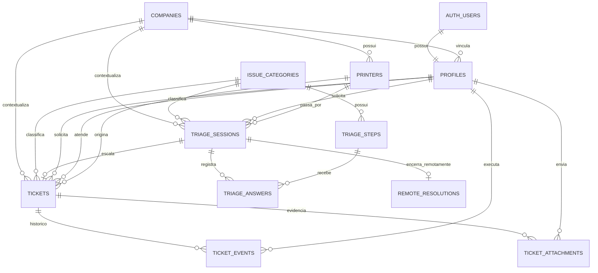

# DER lógico — Narduche v6

## Decisões de modelagem

- dados cadastrais, triagem, atendimento, histórico e evidências possuem responsabilidades separadas;
- `tickets` guarda o estado atual; `ticket_events` guarda o histórico imutável das mudanças operacionais;
- uma sessão de triagem pode terminar em resolução remota **ou** ser escalada para no máximo um chamado;
- anexos ficam no Storage privado; o PostgreSQL armazena apenas metadados e o caminho controlado;
- `audit_log` é separado do histórico do chamado porque registra alterações administrativas em diferentes entidades.
